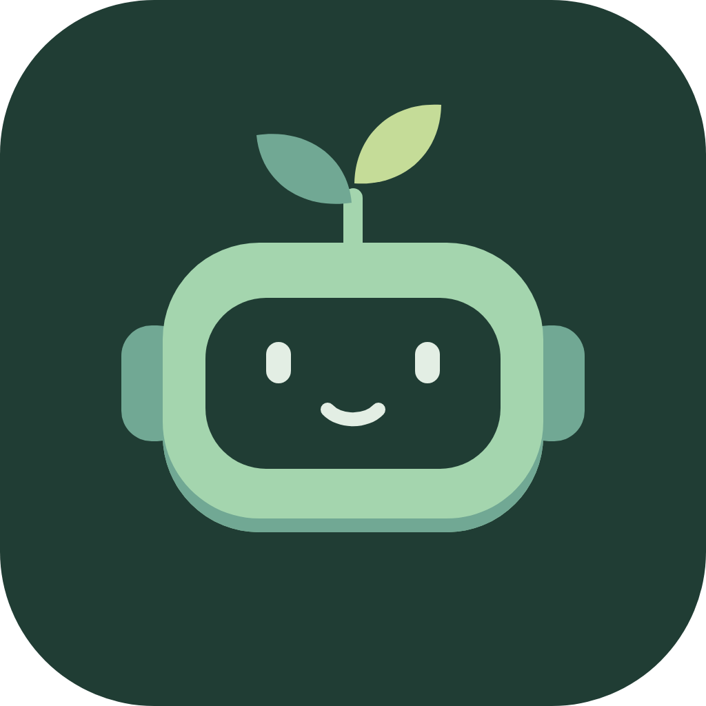

# Bud

A private, playful **GitHub Copilot canvas** companion for beginners and experienced users. Keep learning beyond the daily discovery, practise useful skills, understand local usage, and customize a small bot as it grows.

This version targets the GitHub Copilot app only. There is no standalone product, other-provider integration, leaderboard, or cloud backend.

The repository icon is available as an editable [SVG](assets/bud-icon.svg) and a [1024px PNG](assets/bud-icon.png).

## Install in this repository

Requires Node **22.13+**, npm, and a GitHub Copilot app host that supports experimental canvas extensions.

```powershell
npm ci
npm run build
```

The build produces `.github\extensions\bud\extension.mjs`, package metadata, and third-party license notices. The entry bundles the UI, verified content, and application logic. The SDK is **not bundled**: Copilot supplies `@github/copilot-sdk/extension` when it starts the extension. The pinned development dependency is used for compile-time API checks.

Open this repository in the GitHub Copilot app. Reload extensions (or start a fresh session), then ask:

> Open the Bud canvas.

Project extension discovery requires a Git root. To use Bud in another repository, copy the built `bud` directory into that repository's `.github\extensions\` directory. Do not copy personal profile data or `node_modules`.

The canvas API is experimental. See [GitHub's canvas documentation](https://docs.github.com/en/copilot/how-tos/github-copilot-app/working-with-canvas-extensions). The build targets the SDK 1.0.28 API; the host must provide compatible `createCanvas` and `joinSession` exports.

## What you can do

- Answer a daily question or discover a fact. Learning earns XP regardless of correctness.
- Keep going in **Explore** with learning paths, source-linked lessons, and later review of mistakes.
- Use **Practice** for eight quick checked exercises or five guided real-work challenges. Copy/edit a challenge brief yourself, or separately approve **Send to Copilot** when a connected host is available. Bud never silently sends a prompt or changes your files.
- Choose beginner or experienced recommendations without locking either audience out of content.
- Keep a gentle learning streak through daily discovery, Explore, or Practice. Missing a day never removes XP or cosmetics.
- Equip unlocked colors, headwear, outfits, and titles.
- Collect one-time learning milestones and clearly self-reported habit reflections.
- Read **this session's** local counters or explicitly import **local history**, with per-field coverage and context-sample charts. Bud never estimates spend from transcript length.
- Request a separately consented local checklist review of a pasted prompt or the current session's user prompts. This is not an AI quality grade.

The user and agent share the same service and persistent profile. Canvas actions include `get_profile`, `get_daily_question`, `submit_answer`, `list_achievements`, `equip_item`, and `record_reflection`. Continuous learning uses `get_learning`, `set_experience`, `start_lesson`, `submit_lesson`, `start_challenge`, and `submit_challenge`. Usage actions are `sync_usage`, `sync_history`, and `clear_history`; text-review actions are `review_prompt`, `review_session`, and `clear_review`. Imports and reviews require explicit consent for the corresponding operation. Agents should only call them when the user requests them, and should only record real-work completion after user confirmation.

`send_challenge` requires a separate approval of the exact brief and starting model work. It uses the joined SDK session's `send` method; no imported counters or transcript text are attached. Delivery only means Copilot admitted a message, not that it finished a task. The prompt asks Copilot to coach step by step and request approval before file/configuration changes. Unsupported hosts retain manual copying; delivery errors are surfaced and users are warned to inspect the conversation before retrying.

## Privacy and evidence

Personal progress is stored outside the repository in:

```text
<COPILOT_HOME>\extensions\bud\artifacts\profile.sqlite
```

`COPILOT_HOME` defaults to `~\.copilot`. `BUD_DATA_DIR` can override Bud's data directory. SQLite transactions protect simultaneous windows/processes; no Copilot database is modified.

Usage import reads `<COPILOT_HOME>\session-state\<SESSION_ID>\events.jsonl`. **Read local usage** imports the current session; **Read local history** starts a fresh import of local session directories, newest first. **Read older sessions** extends it with further batches, so history older than the first 100 directories remains accessible. Each explicitly requested batch contains up to 100 directories with a 128 MB read budget; each log is limited to 64 MB. History is an imported snapshot, not a promise of complete lifetime coverage. Changing directories can shift batch boundaries; failed or skipped imports are explained. Re-imports replace session snapshots rather than adding duplicate totals. **Forget imported counters** clears Bud's imported counters, not Copilot's source logs.

Only normalized, allowlisted counters are saved. Transcript bodies, prompts, tool results, credentials, and raw event payloads are not retained. Reading happens on request, not continuously in the background. Malformed lines and unsupported metrics are reported.

**Text review has independent, per-operation consent.** Usage consent does not grant text access. A selected prompt is limited to 6,000 characters; current-session prompt review reads at most an 8 MB log and supports string `user.message.data.content` records. Assistant responses and tool output are not reviewed. Raw text is processed transiently in memory, not persisted or sent to a model by Bud. Only checklist feedback remains in process memory until dismissed or the extension stops. Keyword presence is explicitly not evidence of prompt quality. Unsupported session formats produce an error and offer selected-prompt review instead. Avoid pasting secrets.

Bud has no outbound network requests, analytics, remote fonts, or automatic synchronization. Official source links open only when clicked. **Host behavior is separate:** an agent-callable result enters the Copilot conversation when requested, and Bud cannot change the app's own sync/telemetry settings. Do not request private results in chat if you do not want them in model context.

Counters are marked **Reported**, with field-level coverage. Missing data is **Unavailable**, never silently zero. Context values are samples, not proven peaks. Cache ratios, monetary savings, and "completed a task below half the context window" awards are deliberately unavailable until their evidence can be established. Self-reported reflections are never presented as measured efficiency.

This is a local game, not a fraud-resistant economy: changing your computer clock or editing your own profile can manipulate progress. The server accepts no client-supplied XP, reward IDs, level, or completion dates; ordinary retries and overlapping windows cannot duplicate rewards.

## Learning content

Explore has four paths: prompting/planning, context, agents/verification, and tools/MCP. First lesson completion earns 10 XP, first quick practice earns 15 XP, and a fully confirmed real-work checklist earns 40 XP. Correctness is not required for initial learning XP. Retrying never repeats a first-completion reward; recovering a missed answer on a later profile-local day earns a one-time 10 XP mastery bonus. Daily discovery retains its separate 20 XP daily reward. Practice answers are checked against authored rubrics; real-work completion is explicitly self-reported, never advertised as measured efficiency or agent verification.

Each path has skill progression and a themed wardrobe title unlocked by completing three path items including real work. Earned titles persist even if a source-linked lesson later retires. Both experience settings can access every lesson and challenge; the setting only changes suggestions. Existing daily progress, XP, cosmetics, and profile timezone are preserved when continuous learning is first initialized.

`content\questions.json` contains 37 source-linked quiz/fact entries with category, difficulty, explanation, verification date, and a staleness flag. One disputed compaction-threshold item was excluded. Time-sensitive items stop being newly selected after 90 days until reverified; their dates are never automatically refreshed. Achievements that cannot be reached with the remaining eligible content are marked unavailable until new verified content arrives. Daily selection rotates categories/difficulty, avoids immediate pool repeats, and uses the profile's initial local timezone consistently across sessions.

If daily learning is unavailable (for example after a clock rollback or a content update), Bud shows the reason without disabling the wardrobe, profile, or usage import. Completed discoveries retain their category/difficulty metadata so retiring a question does not erase earned progress.

## Development

```powershell
npm test
npm run typecheck
npm run build
npm run dev
npm run evidence:learning
```

`dev` is a **canvas renderer test harness**, not a separate supported shell. It uses isolated `.bud-dev` storage and explicitly synthetic current-session usage; it never reads your Copilot history. It prints a secret loopback URL and stops on Ctrl+C.

The core has no UI or Copilot SDK dependency. Tests exercise fake usage, question rotation, wrong answers, daily boundaries, idempotent rewards, cosmetic locks, adapter missing/zero semantics, privacy allowlisting, durable transactions, and HTTP request boundaries.

To exercise real runtime discovery and agent actions without sending a model prompt:

```powershell
npx tsx scripts\smoke-host.ts 'C:\path\to\copilot.exe'
```

The smoke uses temporary storage and an experimental extension launch provider. It has passed against Copilot 1.0.105 (protocol 3), including project discovery, canvas open, HTTP response, `get_profile`, and close. The runtime may make startup network calls. This does **not** verify the Copilot app's right-hand panel; the recorded UI evidence covers the actual renderer in Chromium.

Build output is included under `.github\extensions\bud` so the canvas does not require installing runtime packages. Rebuild whenever source/content changes. `evidence\` contains local-only recordings and is ignored by Git.

## Reset or back up

Close Bud canvases and stop the development harness before manipulating storage. Back up the entire Bud data directory, including SQLite WAL/SHM files if present. To reset, move that directory aside while Bud is stopped. Never remove or edit Copilot's own databases to reset Bud.

## Layout

- `src\core`: progress, questions, inventory, and achievement rules.
- `src\adapters\copilot.ts`: read-only current-session JSONL normalization.
- `src\store.ts`: transactional local persistence.
- `src\server.ts`, `src\ui`: protected loopback canvas renderer.
- `src\extension.ts`: host lifecycle and agent-callable actions.
- `content`: verified learning bank.
- `tests`: synthetic unit/integration coverage.
- `SPIKE_REPORT.md`, `DELEGATION_LOG.md`: research provenance and model delegation.
